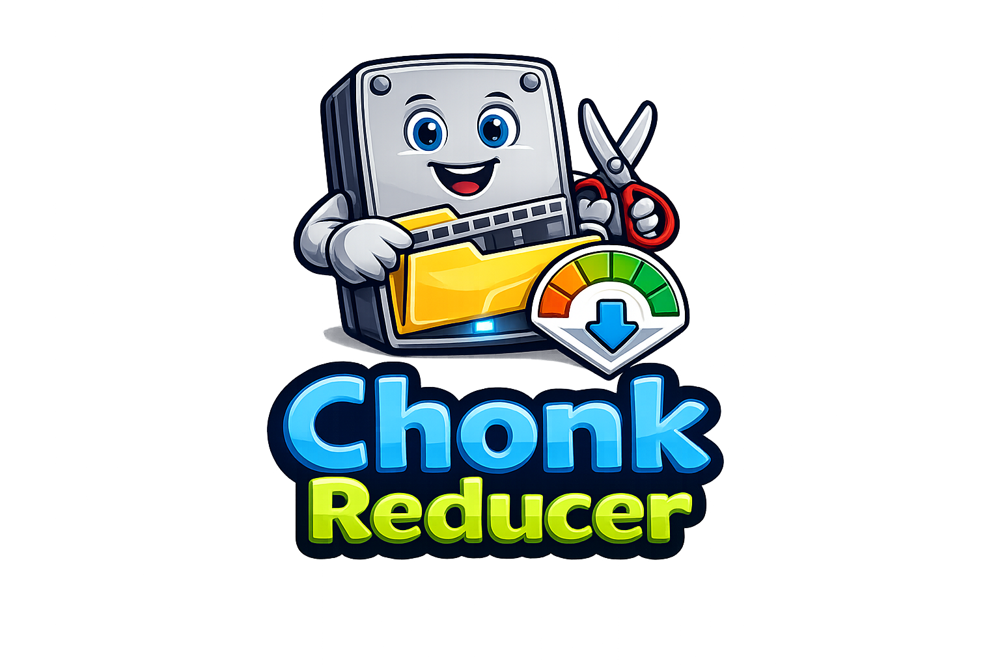
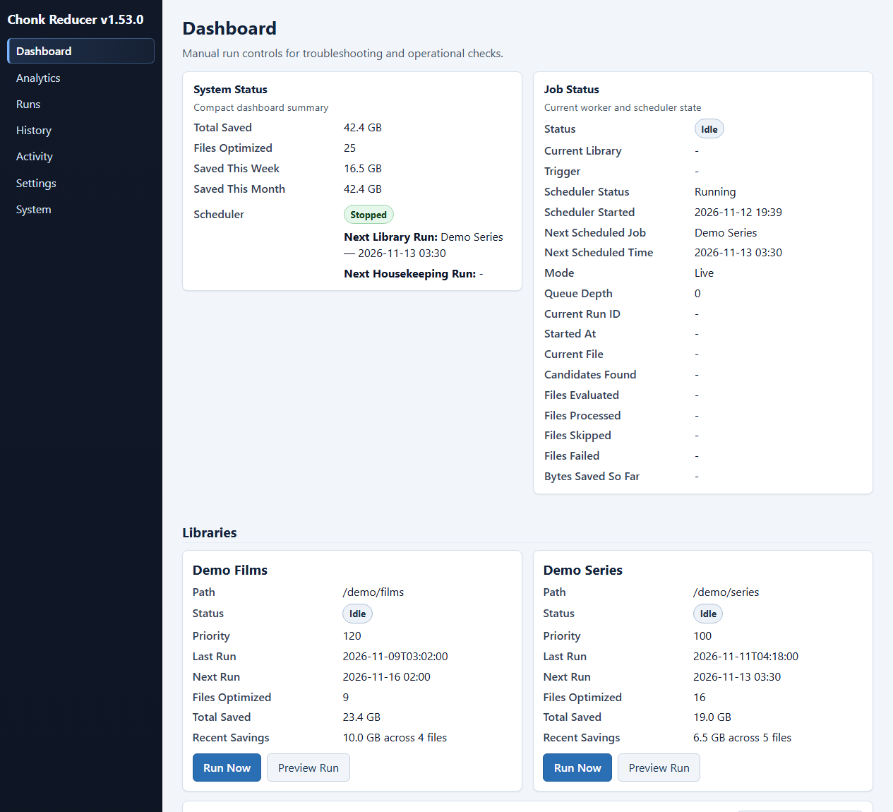

<p align="center">


</p>

# Chonk Reducer

<p align="center">
  
</p>

**Current version:** `v1.53.0`

Chonk Reducer is a Docker-first NAS media optimization service. It finds worthwhile candidates, performs hardware-accelerated Intel QSV HEVC transcodes, validates the output, swaps files safely, and records operational metrics in SQLite.

[Quick Start](#quick-start) · [Operator Reference](docs/REFERENCE.md) · [Testing](docs/TESTING.md) · [Security](SECURITY.md) · [Releases](https://github.com/ckoenig673/chonk-reducer/releases)

## Highlights

- One-shot jobs or a scheduled long-running service.
- Safe preview and dry-run modes before media is changed.
- Policy-based candidate filtering, ranking, and run budgets.
- Validation and atomic swaps with backup and failure markers.
- Dashboard, analytics, history, activity, settings, and system views.
- Per-library schedules, priorities, quality settings, and skip rules.
- Encrypted Discord and generic-webhook configuration.

## Product Preview

The dashboard below was captured from an isolated local demo containing synthetic libraries, filenames, schedules, and savings history. It did not use a NAS, production media, or a production database.



## Quick Start

```bash
git clone https://github.com/ckoenig673/chonk-reducer
cd chonk-reducer
docker compose up -d chonk-service
```

Open the dashboard at `http://localhost:8085/dashboard` and check service health at `http://localhost:8085/health`.

Run a one-shot job instead:

```bash
docker compose run --rm chonk-service run
```

Before processing production media, review the configuration and use a preview or dry run. See the [operator reference](docs/REFERENCE.md#preview-mode-what-it-does--does-not-do) for the exact safety behavior.

## How It Works

1. Discover eligible media files and apply ignore, age, codec, resolution, and size rules.
2. Probe and rank candidates using deterministic savings and history signals.
3. Apply the configured run budget.
4. Encode with retry and backoff.
5. Validate output before an atomic swap.
6. Record run, file, savings, and activity metrics in SQLite.

The Python package separates web presentation, services, persistence, scheduling, and transcoding. The [operator reference](docs/REFERENCE.md#architecture-and-code-layout) documents the complete layout and runtime behavior.

## Web Interface

The service provides operator views for:

- Dashboard and live run status
- Analytics and savings history
- Runs, run detail, and encode history
- Activity and notifications
- Global and per-library settings
- System status and housekeeping

Product screenshots are captured only from sanitized demo environments. See the [screenshot standards](docs/screenshots/README.md).

## Configuration

Deployment concerns such as bind addresses, paths, timezone, and `CHONK_SECRET_KEY` use environment variables. Operational tuning is stored in SQLite and managed through the web interface.

See the [settings inventory](docs/REFERENCE.md#settings-inventory--mapping) for scopes, defaults, and compatibility notes.

## Testing

```bash
python -m pip install -r requirements-dev.txt
pytest -q
```

Tests are designed to run without a NAS, production database, real media library, QSV hardware, or FFmpeg execution. See [docs/TESTING.md](docs/TESTING.md).

## Documentation

- [Documentation index](docs/README.md)
- [Complete operator reference](docs/REFERENCE.md)
- [Testing guide](docs/TESTING.md)
- [Contributing guide](CONTRIBUTING.md)
- [Security policy](SECURITY.md)
- [GitHub releases](https://github.com/ckoenig673/chonk-reducer/releases)

Chonk Reducer is available under the [MIT License](LICENSE).
